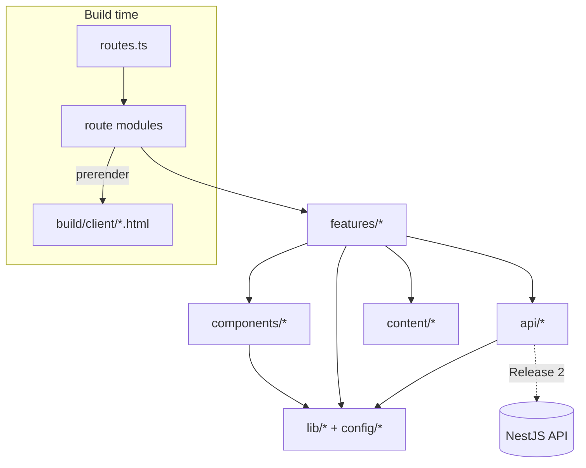
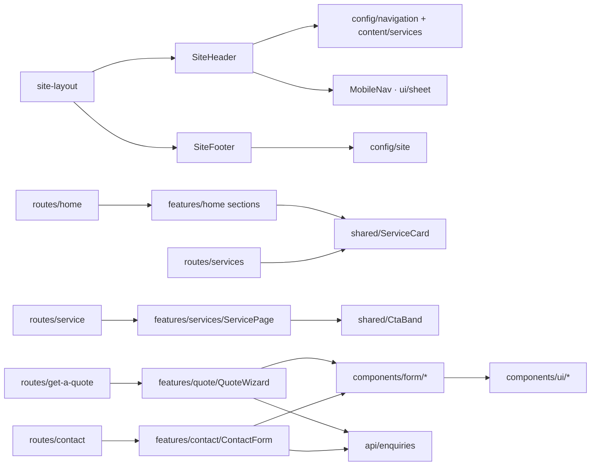

# Architecture

How Kapi Forge's frontend is organised and why. Rules and conventions are in [`CURSOR.md`](../CURSOR.md); this document explains structure and data flow.

## 1. Overview



- **Rendering:** React Router framework mode with `ssr: false` and `prerender: true`. Each static route is rendered to HTML at build time and hydrated in the browser. Output is plain static files.
- **Data:** All Release 1 data is static TypeScript in `content/` and `config/`. There are no loaders, no fetches.
- **Enquiries:** The quote wizard and contact form produce a validated enquiry object. In Release 1, `api/enquiries` turns it into an email/WhatsApp handoff. In Release 2, the same object is POSTed to the API.

## 2. Module responsibilities

| Path                     | Owns                                                                                                                                                                                                                          | Must not                                                                                        |
| ------------------------ | ----------------------------------------------------------------------------------------------------------------------------------------------------------------------------------------------------------------------------- | ----------------------------------------------------------------------------------------------- |
| `src/root.tsx`           | `<html>` document, `Meta`/`Links`/`Scripts`, `MotionConfig` + `LazyMotion`, font preloads, last-resort `ErrorBoundary`                                                                                                        | Contain site chrome (that belongs to the layout route)                                          |
| `src/routes.ts`          | URL → module mapping, layout nesting                                                                                                                                                                                          | Import anything except `@react-router/dev/routes` and `config/paths`                            |
| `src/routes/`            | Route modules: `meta`, `ErrorBoundary` (layout), selecting content, rendering one feature page                                                                                                                                | Contain sections, styling-heavy markup or business logic                                        |
| `src/features/<area>/`   | Everything specific to one product area: sections, feature hooks, feature schemas                                                                                                                                             | Import from another feature                                                                     |
| `src/components/ui/`     | shadcn primitives aligned to tokens                                                                                                                                                                                           | Know about Kapi Forge content                                                                   |
| `src/components/form/`   | RHF-aware field wrappers (`TextField`, `TextareaField`, `SelectField`, `RadioCardGroup`, `CheckboxGroupField`, `DimensionsField`, `FileField`) on a shared `FieldShell`; fields re-validate on change once they show an error | Contain feature-specific validation                                                             |
| `src/components/layout/` | `SiteHeader`, `MobileNav`, `SiteFooter`, `Container`, `Section`                                                                                                                                                               | Hardcode nav items or contact data (read `config/`)                                             |
| `src/components/motion/` | `Reveal`, `Stagger` and similar wrappers over `m.*` using `lib/motion` tokens                                                                                                                                                 | Define their own durations/easings                                                              |
| `src/components/shared/` | Composites reused by 2+ features: `PageHero`, `SectionHeading`, `CtaBand`, `ServiceCard`                                                                                                                                      | Be created for single-use pieces                                                                |
| `src/content/`           | Typed business content: `services.ts` (catalogue), `about.ts`, FAQs                                                                                                                                                           | Contain JSX or components (icons as component references are fine)                              |
| `src/config/`            | `paths.ts`, `site.ts` (verified facts), `navigation.ts`, `env.ts`                                                                                                                                                             | Import heavy libraries (loaded on every route)                                                  |
| `src/api/`               | The integration boundary: enquiry types, handoff link builders, later the HTTP client                                                                                                                                         | Import React, components, or feature runtime code (`import type` of feature schemas is allowed) |
| `src/hooks/`             | Hooks used by 2+ features (`useHydrated`, `useMediaQuery`)                                                                                                                                                                    | Hold feature-specific hooks (keep those in the feature)                                         |
| `src/lib/`               | Pure helpers: `utils.ts` (`cn`), `seo.ts`, `motion.ts`, `gsap.ts`, `validation.ts`, `format.ts`                                                                                                                               | Depend on features or components                                                                |
| `src/styles/`            | `globals.css`: tokens, base styles, custom utilities                                                                                                                                                                          | Contain component styles (use utilities)                                                        |

### Folders intentionally absent

- `constants/` merged into `config/` (one place for app-level values).
- `utils/` is `lib/` (shadcn convention, and the alias it generates).
- `types/` not needed: types are derived next to their source (`content/services.ts` exports `ServiceSlug`, `api/enquiries/types.ts` exports enquiry types). Create `src/types/` only for ambient declarations.
- `services/` named `api/` to avoid confusion with printing _services_ (`content/services.ts`, `features/services/`).

## 3. Routing

### Route table

| URL                           | Module                                  | Route id                      |
| ----------------------------- | --------------------------------------- | ----------------------------- |
| `/`                           | `routes/home.tsx`                       | (default)                     |
| `/services`                   | `routes/services.tsx`                   | (default)                     |
| `/services/3d-printing`       | `routes/service.tsx`                    | `service-3d-printing`         |
| `/services/digital-printing`  | `routes/service.tsx`                    | `service-digital-printing`    |
| `/services/offset-printing`   | `routes/service.tsx`                    | `service-offset-printing`     |
| `/prototyping`                | `routes/service.tsx`                    | `service-prototyping`         |
| `/bulk-printing`              | `routes/service.tsx`                    | `service-bulk-printing`       |
| `/about`                      | `routes/about.tsx`                      | (default)                     |
| `/contact`                    | `routes/contact.tsx`                    | (default)                     |
| `/get-a-quote`                | `routes/get-a-quote.tsx`                | (default)                     |
| `*`                           | `routes/not-found.tsx`                  | (default)                     |
| `/sitemap.xml`, `/robots.txt` | `routes/sitemap.ts`, `routes/robots.ts` | resource routes, pre-rendered |

All page routes are children of `layout('routes/site-layout.tsx')`. A future admin area gets a sibling layout (`layout('routes/admin-layout.tsx', [...])`) with its own chrome and auth guard, and is excluded from `prerender`.

```ts
// src/routes.ts (target shape)
export default [
  route('sitemap.xml', 'routes/sitemap.ts'),
  route('robots.txt', 'routes/robots.ts'),
  layout('routes/site-layout.tsx', [
    index('routes/home.tsx'),
    route('services', 'routes/services.tsx'),
    route('services/3d-printing', 'routes/service.tsx', { id: 'service-3d-printing' }),
    route('services/digital-printing', 'routes/service.tsx', { id: 'service-digital-printing' }),
    route('services/offset-printing', 'routes/service.tsx', { id: 'service-offset-printing' }),
    route('prototyping', 'routes/service.tsx', { id: 'service-prototyping' }),
    route('bulk-printing', 'routes/service.tsx', { id: 'service-bulk-printing' }),
    route('about', 'routes/about.tsx'),
    route('contact', 'routes/contact.tsx'),
    route('get-a-quote', 'routes/get-a-quote.tsx'),
    route('*', 'routes/not-found.tsx'),
  ]),
] satisfies RouteConfig
```

Explicit routes are used instead of `services/:slug` because two services live outside `/services/` and because `prerender: true` only pre-renders static paths.

### Route module pattern

```tsx
// routes/service.tsx
import { data, useLocation } from 'react-router'
import type { Route } from './+types/service'
import { getServiceByPath } from '@/content/services'
import { ServicePage } from '@/features/services/components/ServicePage'
import { buildMeta } from '@/lib/seo'

export const meta: Route.MetaFunction = ({ location }) => {
  const service = getServiceByPath(location.pathname)
  return service ? buildMeta({ ...service.seo, path: service.path }) : []
}

export default function ServiceRoute() {
  const service = getServiceByPath(useLocation().pathname)
  if (!service) throw data(null, { status: 404 })
  return <ServicePage service={service} />
}
```

### Layout, errors and navigation state

- `routes/site-layout.tsx` renders the skip link, `SiteHeader`, `<ViewTransition><main><Outlet/></main></ViewTransition>` and `SiteFooter`. It also exports an `ErrorBoundary` so a crashing page keeps the header and footer. `root.tsx`'s boundary is the last resort.
- Not found: the `*` route renders `NotFoundRoute` (with `noindex`). Lookups that fail inside a page throw `data(null, { status: 404 })`, which the layout boundary renders as the same not-found UI.
- Active navigation: `NavLink` with `end` for exact matches. The "Services" item is active for any service path; derive this from `services.some(s => s.path === pathname)`, not from a URL prefix (two services are outside `/services`).
- The mobile nav closes on navigation (`useLocation` effect) and on `Escape` (Radix Dialog).
- Scroll is restored by `<ScrollRestoration />`; hash links scroll with `scroll-padding-top` for the sticky header.

### SEO metadata

Every route exports `meta` via `buildMeta()` (title, description, canonical, Open Graph, Twitter card, optional `noindex`). JSON-LD is rendered as `<script type="application/ld+json">` in the home and contact route components from `siteConfig`, omitting `null` fields.

## 4. Service pages

All five service pages render one template, `features/services/components/ServicePage.tsx`, driven by `content/services.ts`. Adding a service means adding a catalogue entry, a path and a route line; never a new page component.

```ts
// content/services.ts (target shape; identity fields exist today)
type ServiceContent = {
  slug: '3d-printing' | 'digital-printing' | 'offset-printing' | 'prototyping' | 'bulk-printing'
  name: string // "3D Printing"
  path: AppPath
  icon: LucideIcon
  summary: string // card text on Home and /services
  seo: { title: string; description: string }
  hero: { eyebrow: string; headline: string; intro: string; image?: ImageAsset } // Release 1 ships without photography; add `image` only for real assets
  highlights: { title: string; description: string; icon: LucideIcon }[] // 3–4
  offerings: { title: string; items: string[] }[] // what can be produced
  process: { title: string; description: string }[] // 3–5 steps
  fileGuidance?: { formats: string[]; notes: string[] } // accepted formats
  faqs: { question: string; answer: string }[]
}
type ImageAsset = { src: string; srcSet?: string; width: number; height: number; alt: string }
```

`ServicePage` composes sections in a fixed order, each a component in `features/services/components/`: `ServiceHero`, `ServiceHighlights`, `ServiceOfferings`, `ServiceProcess`, `ServiceFileGuidance` (only if present), `ServiceFaqs` (shadcn Accordion), then shared `CtaBand` linking to `paths.getAQuote + '?service=' + slug`. Sections render nothing when their data is empty, so content can be filled incrementally without placeholders.

The `/services` overview maps the same catalogue to `ServiceCard`s. Navigation menus also read the catalogue, so names and paths are defined once.

## 5. Contact

`features/contact/` contains `ContactDetails` (renders only non-null `siteConfig.contact` fields as real `mailto:`/`tel:`/`wa.me` links) and `ContactForm` (name, email, phone optional, service interest optional, message). The form uses the same handoff mechanism as the quote (§6.8).

## 6. Quote system

### 6.1 Structure

```
features/quote/
├─ components/
│  ├─ QuoteWizard.tsx          owns useForm, FormProvider, step index, draft hook; renders current step
│  ├─ QuoteProgress.tsx        step indicator (ol, aria-current="step")
│  ├─ StepActions.tsx          Back / Continue buttons
│  ├─ steps/
│  │  ├─ ServiceStep.tsx       radio cards bound to `service`
│  │  ├─ SpecificationsStep.tsx renders the selected service's field definitions + FileField
│  │  ├─ DetailsStep.tsx       customer and delivery fields
│  │  └─ ReviewStep.tsx        summary with "Edit" links per section + EnquiryActions
│  ├─ SpecField.tsx            maps one FieldDefinition to a components/form wrapper
│     (EnquiryActions lives in components/shared/: the contact form uses it too, and features may not import features)
├─ specs/
│  ├─ types.ts                 FieldDefinition, ServiceSpec
│  ├─ three-d-printing.ts      fields + schema + defaults + file rules, one file per service
│  ├─ digital-printing.ts
│  ├─ offset-printing.ts
│  ├─ prototyping.ts
│  ├─ bulk-printing.ts
│  └─ index.ts                 serviceSpecs: Record<ServiceSlug, ServiceSpec>
├─ schema.ts                   quoteSchema (discriminated union), QuoteFormValues, step field map
├─ steps.ts                    ordered step definitions
├─ files.ts                    file rules and validateFiles()
├─ summary.ts                  buildQuoteSummary(values) → sections/rows (used by review + handoff)
└─ hooks/
   ├─ useQuoteDraft.ts         sessionStorage save/restore
   └─ useQuotePrefill.ts       applies ?service= after mount
```

The route module `routes/get-a-quote.tsx` sets `meta` and renders `<QuoteWizard />`.

### 6.2 Form model

```ts
// schema.ts
const baseSchema = z.object({
  files: z.array(fileSchema).max(MAX_FILES),
  customer: customerSchema,
  notes: z.string().max(1000).optional(),
})

export const quoteSchema = z
  .discriminatedUnion(
    'service',
    serviceSlugs.map((slug) =>
      baseSchema.extend({ service: z.literal(slug), specifications: serviceSpecs[slug].schema }),
    ),
  )
  .superRefine(validateFilesForService)

export type QuoteFormValues = z.input<typeof quoteSchema>
export type QuoteEnquiryValues = z.output<typeof quoteSchema>
```

- **One `useForm` for the whole wizard**, so the review step and the handoff read one validated object. Steps read and write through `useFormContext`.
- `specifications` is keyed by `service`. When the service changes, `QuoteWizard` replaces `specifications` with that service's `defaults` and clears `files` if the new service does not accept them. Customer details are kept.
- `customerSchema` composes primitives from `lib/validation.ts`: name, optional company, email, Indian mobile (`+91` optional, 10 digits starting 6–9), city, PIN code (`/^[1-9]\d{5}$/`), delivery address, optional required-by date (today or later).

### 6.3 Dynamic specification fields

Each service spec file declares its options once and uses them for both the schema and the UI:

```ts
// specs/three-d-printing.ts (illustrative; option lists need business confirmation)
const materials = [
  { value: 'pla', label: 'PLA' },
  { value: 'petg', label: 'PETG' },
  { value: 'abs', label: 'ABS' },
  { value: 'resin', label: 'Resin' },
  { value: 'not-sure', label: 'Not sure, recommend one' },
] as const

const schema = z.object({
  material: z.enum(optionValues(materials)),
  quantity: z.number().int().min(1),
  dimensions: dimensionsSchema.optional(),
  colour: z.string().max(60).optional(),
  finish: z.enum(optionValues(finishes)),
  purpose: z.enum(['prototype', 'production']),
})

export const threeDPrintingSpec = {
  slug: '3d-printing',
  schema,
  defaults: { material: 'not-sure', quantity: 1, finish: 'as-printed', purpose: 'prototype' },
  fields: [
    { kind: 'select', name: 'material', label: 'Material', options: materials },
    { kind: 'number', name: 'quantity', label: 'Quantity', min: 1 },
    {
      kind: 'dimensions',
      name: 'dimensions',
      label: 'Approximate size',
      unit: 'mm',
      optional: true,
    },
    // …
  ],
  files: { requirement: 'required', accept: ['.stl', '.obj', '.step', '.stp', '.3mf'] },
} satisfies ServiceSpec<typeof schema>
```

```ts
// specs/types.ts
type FieldDefinition<TName extends string = string> = {
  name: TName
  label: string
  description?: string
  optional?: boolean
  visibleWhen?: (specs: Record<string, unknown>) => boolean // e.g. custom size when paperSize === 'custom'
} & (
  | { kind: 'select' | 'radio'; options: readonly FieldOption[] }
  | { kind: 'checkbox-group'; options: readonly FieldOption[] }
  | { kind: 'number'; min?: number; max?: number; unit?: string }
  | { kind: 'text' | 'textarea'; placeholder?: string; maxLength?: number }
  | { kind: 'dimensions'; unit: 'mm' | 'cm' }
)
```

- `SpecificationsStep` maps `serviceSpecs[service].fields` through `SpecField`, prefixing names with `specifications.`. `SpecField` is a `switch` on `kind` returning a `components/form` wrapper; there is no other rendering path.
- Conditional fields use `visibleWhen` for display and a `superRefine` in the same spec file for validation. Hidden fields are unregistered (`shouldUnregister` on that field) so stale values are not submitted.
- The schema is written by hand, not generated from `fields`. Field definitions are typed against the schema keys (`satisfies`), so a renamed field fails type-checking.
- Initial field sets per the brief: 3D printing (files, material, dimensions, quantity, colour, finish, prototype/production); digital (product type, paper size, GSM, colour, single/double-sided, quantity, finishing); offset (product type, paper specification, quantity, colours, binding, finishing, delivery). Prototyping and bulk use a short structured set plus a required project description; confirm with the business.

### 6.4 Steps and navigation

```ts
// steps.ts
export const quoteSteps = [
  { id: 'service', title: 'Service', fields: ['service'] },
  { id: 'specifications', title: 'Specifications', fields: ['specifications', 'files'] },
  { id: 'details', title: 'Your details', fields: ['customer', 'notes'] },
  { id: 'review', title: 'Review', fields: [] },
] as const
```

- Each step also carries its `heading` and `description` copy. Continue: `await trigger(step.fields, { shouldFocus: true })`; advance only if valid. Back never validates. Before entering review, `findInvalidStep(values)` re-checks the whole form, so a restored or edited draft cannot reach the handoff while invalid. Radio groups are not focusable, so the wizard focuses the first control inside the first `[aria-invalid]` group.
- The progress indicator lets users jump back to completed steps only.
- On step change: focus the step's `<h2 tabIndex={-1}>`, scroll the wizard top into view, and update a polite live region ("Step 2 of 4, Specifications").
- Step content fades in with an 8 px lift (`duration.base`) via a keyed `m.div`. There is no exit animation: the new heading must exist in the same commit so focus can move to it immediately.
- Step index is local state, not in the URL. It is persisted with the draft.

### 6.5 Draft persistence

`useQuoteDraft(form, onRestore)` returns `{ restored, saveStep }`. The wizard calls `saveStep` on every user-driven step change; restoring a draft never goes through it, so a restored step is not overwritten and does not steal focus:

- Key `kapi-forge:quote-draft:v1` in **`sessionStorage`** (tab-scoped; avoids leaving personal data on shared machines). Bump the version when the schema changes shape; drop unparseable drafts silently.
- Saves `{ values without files, stepIndex, savedAt }`, debounced 500 ms, via `form.subscribe` (no re-render).
- Restores once after mount (`useEffect`), validating the stored object with `quoteSchema.safeParse` on a best-effort basis (invalid parts fall back to defaults).
- **Files are never persisted.** If a restored draft's service requires files, the specifications step shows "Please re-attach your files".
- Cleared by "Start a new quote".
- `?service=` prefill (from service page CTAs) is applied after mount and only when no draft exists.

### 6.6 Files

`files.ts` defines limits (initially 10 files, 50 MB each; adjust with the business) and per-service `accept` lists. `FileField` is a native `<input type="file" multiple>` wrapped in a keyboard-accessible drop zone.

- Validation: extension against the service's `accept` list (case-insensitive), size, count, duplicates. Errors are listed per file.
- `File` objects live only in React Hook Form state, in memory. They are never read, encoded or stored.
- In Release 1, files cannot travel with an email/WhatsApp handoff. The review step lists the selected file names and tells the user to attach them in their email app. In Release 2 they upload to private storage (see backend doc).
- The file schema is `z.custom<File>((value) => typeof File !== 'undefined' && value instanceof File)` so the module is safe during pre-rendering.

### 6.7 Review

`buildQuoteSummary(values)` returns `{ title, rows: { label, value }[] }[]` (service, specifications with option labels resolved from field definitions, files, customer). The review step renders it, with "Edit" buttons that jump to the owning step. The same summary is used for the handoff text, so what the user reviews is what is sent.

### 6.8 Enquiry handoff and outcomes

```ts
// api/enquiries/types.ts
export type HandoffChannel = 'email' | 'whatsapp'
export type EnquiryOutcome =
  | { status: 'handoff'; channel: HandoffChannel }
  | { status: 'submitted'; reference: string } // Release 2
  | { status: 'error'; message: string; retryable: boolean } // Release 2

// api/enquiries/handoff.ts (pure, unit tested)
export function buildEmailHandoff(summary: EnquirySummary): string | null // null if no business email
export function buildWhatsAppHandoff(summary: EnquirySummary): string | null
```

- `EnquiryActions` renders one real link per configured channel ("Continue in email", "Continue on WhatsApp") and a "Copy enquiry details" button. Unconfigured channels are not rendered. If no channel is configured, only copy is shown, plus a development-only console warning.
- After a handoff click the step shows an honest outcome: "Your email app should open with your enquiry. Attach your files and press send. We receive your enquiry only when you send it." Never "submitted" or "received".
- Keep `mailto:` bodies under ~1,800 characters: the summary builder has a compact mode that truncates notes with "(continued in attachment)".
- Release 2 replaces the actions with a submit button calling `submitQuote()`; the `EnquiryOutcome` union already covers its states, so the wizard does not change shape.

## 7. Component relationships



## 8. Decisions and trade-offs

| Decision                                                    | Why                                                                                                                                                                 | Cost                                                                |
| ----------------------------------------------------------- | ------------------------------------------------------------------------------------------------------------------------------------------------------------------- | ------------------------------------------------------------------- |
| Framework mode + pre-rendering instead of a client-only SPA | Real HTML per page for crawlers and link previews (WhatsApp/LinkedIn do not run JS), faster first paint, built-in `meta`/`ErrorBoundary`, automatic route splitting | Code must be SSR-safe; Vitest runs without the router plugin        |
| One shared `service.tsx` module with explicit routes        | One template, URL scheme kept as specified                                                                                                                          | Five route lines instead of one dynamic route                       |
| Single RHF form for the wizard                              | One source of truth for review and handoff; simple step validation with `trigger`                                                                                   | Large schema; mitigated by per-service spec files                   |
| Hand-written Zod schemas next to field definitions          | Explicit, type-checked, no schema-generation magic                                                                                                                  | Field list and schema must be edited together (type-checked)        |
| Email/WhatsApp handoff in Release 1                         | Gives real enquiry paths without a backend and without pretending                                                                                                   | Files must be attached manually; needs verified contact details     |
| `sessionStorage` drafts                                     | Protects personal data on shared devices                                                                                                                            | Drafts do not survive closing the tab                               |
| No global store, no TanStack Query yet                      | No shared client state or server state exists                                                                                                                       | Added later with clear triggers                                     |
| `cn` package instead of `clsx` + `tailwind-merge`           | It is what the current shadcn registry imports; one dependency                                                                                                      | Young package (0.x); wrapped in `lib/utils.ts` so it can be swapped |

### Known limitations

- Unknown URLs return the SPA fallback with HTTP 200 unless the host is configured to serve the fallback with status 404 (soft 404s). Configure per host at deploy time.
- Two service URLs (`/prototyping`, `/bulk-printing`) sit outside `/services/`. This is kept as specified; changing it later needs redirects.
