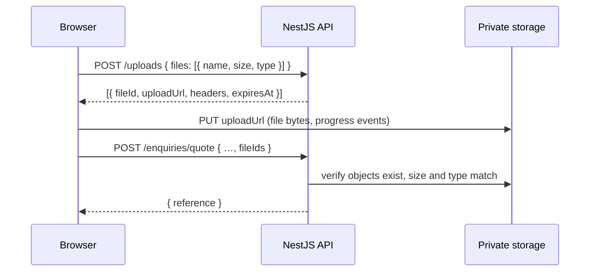

# Future backend integration

How the frontend will connect to the planned backend (NestJS, PostgreSQL, Prisma, private object storage), and which boundaries exist today so that integration does not require a rewrite.

**Nothing in this document is built in Release 1** except the enquiry types and handoff link builders in `src/api/enquiries/` (see [architecture §6.8](architecture.md#68-enquiry-handoff-and-outcomes)). Do not add an HTTP client, mock server or fake endpoints before a real API exists.

## 1. Principles

1. **One boundary.** All network access lives in `src/api/`. Components and features call typed functions; they never call `fetch` or know URLs.
2. **The frontend stays static.** The public site remains pre-rendered static files. The API is a separate origin (`VITE_API_BASE_URL`), so neither deploy depends on the other.
3. **Validated before sent.** The Zod schemas that validate forms today define the payloads sent tomorrow. The backend validates again (class-validator DTOs or a shared Zod package); the frontend never trusts its own validation for security.
4. **Honest states.** UI states come from the `EnquiryOutcome` union; the UI shows "submitted" only when the API returns a reference.

## 2. Backend modules and frontend consumers

| Backend module   | Release | Frontend consumer                                                                      |
| ---------------- | ------- | -------------------------------------------------------------------------------------- |
| Enquiries        | 2       | Contact form, quote wizard submit                                                      |
| File uploads     | 2       | Quote wizard file step (presigned uploads)                                             |
| Quotations       | 2–3     | Customer quote view (`/quotes/:reference`), admin                                      |
| Notifications    | 2       | None directly (email/WhatsApp confirmations sent by backend)                           |
| Customers, Users | 3       | Account area, admin                                                                    |
| Authentication   | 3       | Admin dashboard, customer accounts                                                     |
| Orders           | 3       | Account area, admin                                                                    |
| Admin dashboard  | 3       | Separate layout route (`routes/admin-layout.tsx`), not pre-rendered, or a separate app |

## 3. Environment

| Variable            | Release 1              | Release 2+                         |
| ------------------- | ---------------------- | ---------------------------------- |
| `VITE_SITE_URL`     | Required in production | Required                           |
| `VITE_API_BASE_URL` | Unset                  | e.g. `https://api.kapiforge.in/v1` |

Read only through `src/config/env.ts`. `VITE_*` values are public: never put secrets, API keys or storage credentials in them. Presence of `env.apiBaseUrl` is the switch between handoff mode and API mode.

## 4. API layer (to create with the first endpoint)

```
src/api/
├─ client.ts              apiRequest(): base URL, JSON, timeout, error normalisation
├─ errors.ts              ApiError type and helpers
├─ enquiries/
│  ├─ types.ts            (built in Release 1) enquiry payloads, EnquiryOutcome
│  ├─ handoff.ts          (built in Release 1) email/WhatsApp link builders
│  └─ enquiries.ts        submitQuote(), submitContact()
└─ uploads/
   └─ uploads.ts          requestUploadUrls(), uploadFile()
```

### Client

A small wrapper over native `fetch`; no Axios.

```ts
type ApiRequestOptions = {
  method?: 'GET' | 'POST' | 'PATCH' | 'DELETE'
  body?: unknown
  signal?: AbortSignal
}

export async function apiRequest<T>(path: string, options: ApiRequestOptions = {}): Promise<T>
// - prefixes env.apiBaseUrl; throws if it is unset
// - sends/accepts JSON, sets credentials: 'include' only once cookie auth exists
// - 15 s timeout via AbortSignal.any([options.signal, AbortSignal.timeout(15_000)])
// - non-2xx → throws ApiError parsed from the error envelope
```

### Error convention

NestJS returns a consistent envelope (configured with a global exception filter):

```ts
type ApiErrorBody = {
  statusCode: number
  code: string // stable machine code: 'VALIDATION_FAILED', 'FILE_TOO_LARGE', 'RATE_LIMITED'
  message: string // safe to show to users
  fieldErrors?: Record<string, string[]> // keyed by the same paths as the form ('customer.email')
  requestId?: string
}

class ApiError extends Error {
  status: number
  code: string
  fieldErrors?: Record<string, string[]>
  requestId?: string
  get retryable() {
    return this.status >= 500 || this.status === 429 || this.status === 0
  }
}
```

The form layer maps `fieldErrors` back with `form.setError(path, …)`; other errors become `{ status: 'error', message, retryable }`. Network failures produce `status: 0`.

### Request/response types

Payloads are derived from the existing schemas, so the form and the request cannot drift:

```ts
// api/enquiries/types.ts
export type CreateQuoteEnquiryRequest = {
  service: ServiceSlug
  specifications: QuoteEnquiryValues['specifications']
  customer: Customer
  notes?: string
  fileIds: string[] // from the upload step; never File objects
}
export type CreateEnquiryResponse = { reference: string; createdAt: string }
```

When the backend exists, move the Zod schemas into a shared workspace package (e.g. `packages/schemas`) consumed by both apps, or generate TypeScript types from the NestJS OpenAPI document. Choose one; do not maintain both.

### Server state

Introduce TanStack Query together with the first **read** endpoint (quote status, account data, admin lists). Mutations used only by forms (submit enquiry) can be plain async functions called from the form's submit handler; adopt `useMutation` once Query is present.

## 5. File uploads

Files go directly from the browser to private object storage (S3-compatible: AWS S3, Cloudflare R2, DigitalOcean Spaces). They do not stream through NestJS.



- Client-side limits in `features/quote/files.ts` mirror server limits; the server is authoritative.
- Upload with `XMLHttpRequest` (for progress events) wrapped in `uploadFile(file, target, { onProgress, signal })`.
- Objects are private; staff access them through short-lived signed GET URLs from the admin API. No public bucket URLs.
- Server side: malware scanning and content-type sniffing before files are visible to staff; unreferenced uploads expire after 24 h.
- Upload starts when the user continues past the specifications step (or on submit) so the final submit is fast; the UI shows per-file progress and retry.

## 6. Switching the quote wizard to API mode

1. Implement `api/client.ts`, `api/errors.ts`, `api/enquiries/enquiries.ts`, `api/uploads/uploads.ts`.
2. In `EnquiryActions`, render a submit button when `env.apiBaseUrl` is set, otherwise the existing handoff actions. The wizard, steps, schemas and summary do not change.
3. On success, show the reference and clear the draft. On `retryable` errors, keep the draft and offer retry. Map `fieldErrors` to fields and jump to the owning step.
4. Add privacy notice and consent text required for storing personal data.
5. Add spam protection (Cloudflare Turnstile or similar) to both forms; the token is sent with the request and verified by the API.
6. Keep handoff links as a fallback when the API is unreachable.

## 7. Authentication (Release 3)

- Session cookies (`HttpOnly`, `Secure`, `SameSite=Lax`) issued by the API; no tokens in `localStorage`.
- API on a subdomain of the site domain so cookies work; CORS allowlist for the site origin only.
- Admin routes are client-rendered (excluded from `prerender`), guarded in a `clientLoader` on the admin layout that redirects to login, with authorisation enforced again by the API.
- A full admin dashboard may be better as a separate app in the same repo (monorepo) sharing `packages/schemas` and the design tokens; decide when Release 3 is scoped.

## 8. Checklist before the first API call

- [ ] API base URL and CORS configured per environment
- [ ] Error envelope implemented server-side
- [ ] Rate limiting and spam protection on public endpoints
- [ ] Privacy notice published
- [ ] Shared schema or generated types decided
- [ ] `CURSOR.md` §2 and §8 updated (TanStack Query, API mode)
